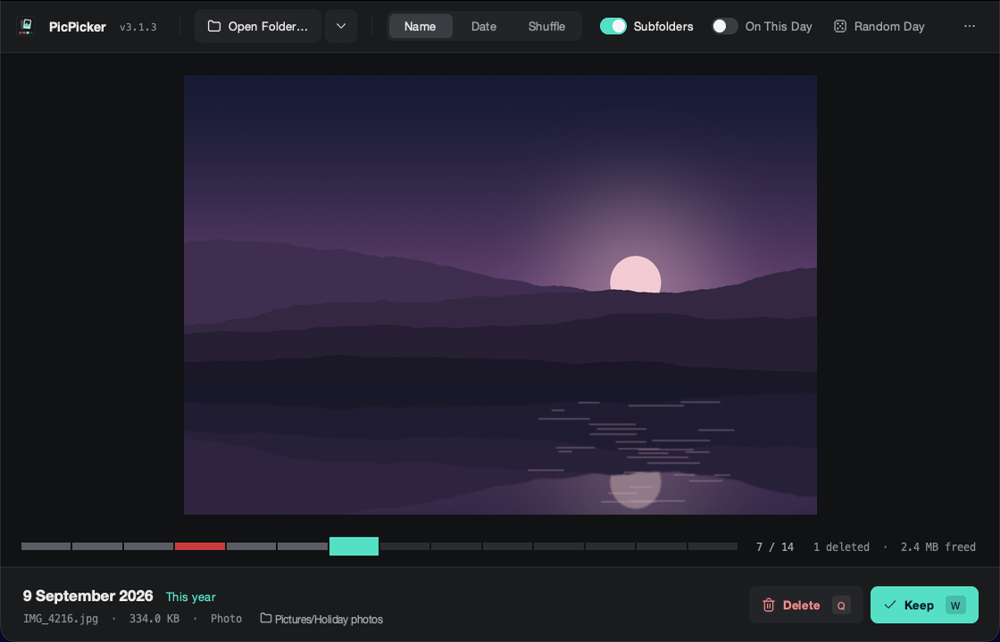
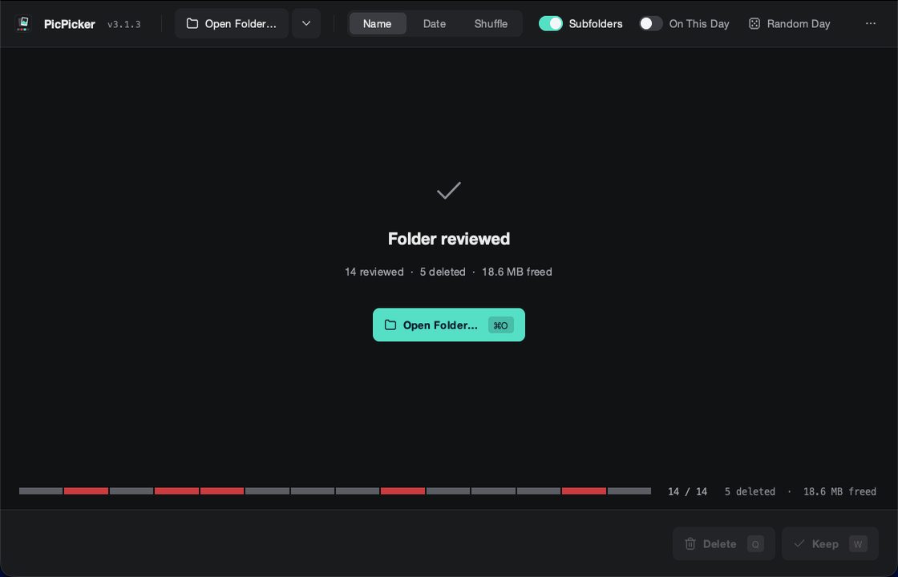
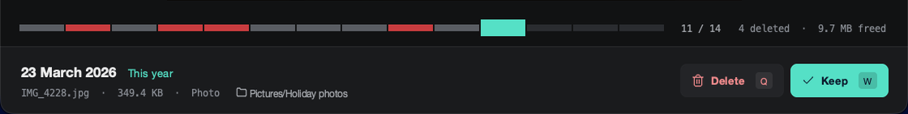
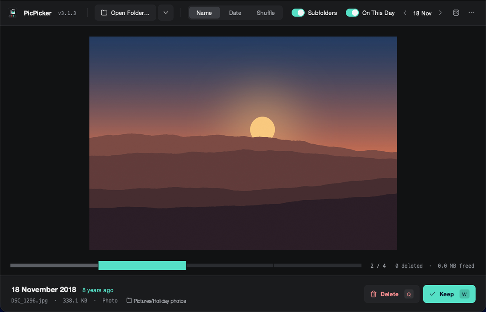
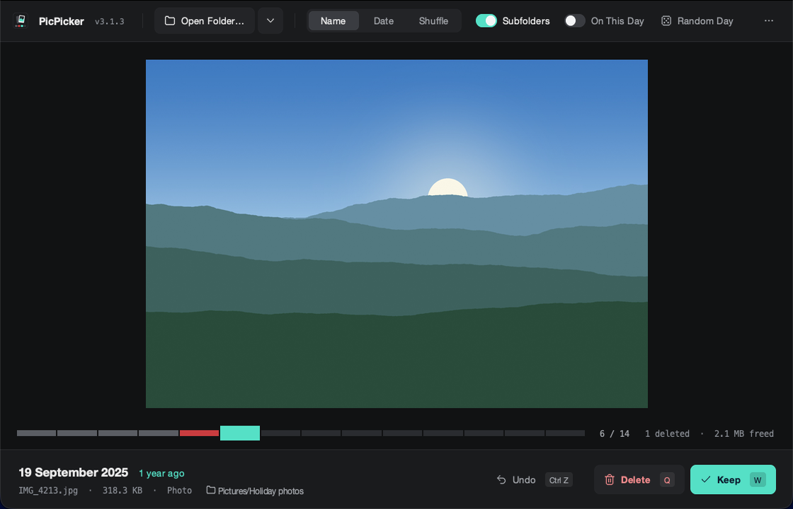
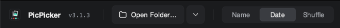

Clear out a folder of photos and videos one at a time: keep the good ones, bin the rest. Works offline. No tracking.

**Contents:** [What it does](#what-it-does) · [Privacy](#privacy) · [Download](#download) · [How to use](#how-to-use) · [For developers](#for-developers) · [License](#license)



## What it does

PicPicker shows the photos and videos in a folder one at a time. You decide on each one with a single key press.

### Keep or delete, one key each



Press `W` to keep a photo or `Q` to send it to the Recycle Bin or Trash. Kept files stay exactly where they are. At the end, you see how many files you reviewed and how much space you freed.

### See your place in the folder



The strip under the photo shows the whole folder, one block per file. You see what you've passed, what you deleted and where you are now.

### On This Day



See only the photos and videos taken on today's date, in every year. **Random Day** takes you to a random date that has photos.

### Undo a delete



Deleted a photo by mistake? **Undo** brings it back and shows it again. Undo is available on Windows.

### Choose the order



Go through the folder by name, by date or in a random order.

## Privacy

- **Works offline.** Every feature except the update check works with no internet
  connection.
- **No tracking.** The app has no telemetry, analytics, crash reports or accounts.
- **One network connection, only when you ask.** When you select the version
  number, the app asks GitHub (api.github.com) for the latest release. It sends
  nothing else and nothing is downloaded. **Open release page** opens the release
  page in your browser.
- **Your photos stay where they are.** The app never writes into your photo
  folders. It changes a file only when you delete it.
- **Saved data stays on your computer.** To make repeat visits fast, the app saves
  file dates, video previews and your last three folders:
  - **Windows:** in a `cache` folder beside `PicPicker.exe`
  - **macOS:** in `~/Library/Application Support/PicPicker`
  - **Linux:** in `~/.local/share/picpicker`

To remove previews of videos you have deleted, select **…** › **Clear Thumbnail
Cache…** in the toolbar.

## Download

PicPicker runs on 64-bit Windows, a Mac with Apple silicon (M1 or
later), or 64-bit Linux with a desktop (Ubuntu 22.04 or newer). Intel Macs aren't
supported.

1. Open [Releases](https://github.com/TariqMK/PicPicker/releases).
2. Under **Assets**, download the file for your computer:

   | Your computer | Download | Then open |
   | --- | --- | --- |
   | Windows (64-bit) | `windows-x64.zip` | `PicPicker/PicPicker.exe` |
   | Mac with Apple silicon | `macos-arm64.zip` | `PicPicker.app` |
   | Linux (64-bit) | `linux-x64.tar.gz` | `PicPicker/PicPicker` |

3. Extract the download to a folder you can write to, such as Documents. Keep
   everything inside it together.
4. Open the file shown in **Then open**.

You don't need to install Python or anything else to run it.

### Opening on Windows

PicPicker isn't signed, so Windows may warn you the first time. If SmartScreen
says it protected your PC, click **More info**, then **Run anyway**.

### Opening on macOS

PicPicker isn't notarised by Apple, so macOS shows a warning the first time you open it. This is expected and doesn't mean the app is harmful.

1. Open PicPicker and click **Done** on the warning.
2. Open **System Settings → Privacy & Security**, scroll down to the message saying "PicPicker" was blocked, and click **Open Anyway**.
3. Enter your password, then click **Open** on the next prompt. You only need to do this once.

<details>
<summary>If you use Terminal</summary>

You can run this instead. Change the path if PicPicker is in another folder:

    xattr -dr com.apple.quarantine "/Applications/PicPicker.app"

</details>

### Optional: video previews

To see video thumbnails and use the date a video was recorded, install
[FFmpeg](https://ffmpeg.org/download.html) so that `ffmpeg` and `ffprobe` are on
your system `PATH`. On Windows, `winget install ffmpeg` does this. Without FFmpeg
you can still review videos and open them in your usual player.

## How to use

### Review a folder

**Caution:** there is no "are you sure?" prompt. One press of `Q` sends a file to
the bin. For your first session, try a copy of a folder on your computer's own drive.

1. Click **Open Folder…** (`Ctrl+O`, or `Cmd+O` on a Mac) and pick a folder. Leave
   **Subfolders** on to include every folder inside it.
2. Each photo or video appears in turn. Press **Keep** (`W`) to move on, or
   **Delete** (`Q`) to send it to the Recycle Bin.
3. To bring back the last file you deleted, press **Undo** (`Ctrl+Z` or Backspace).
   It shows the file again. Undo is available on Windows.
4. When you reach the end, read how many files you reviewed and how much space
   you freed.

Under each photo you'll see the date it was taken, how many years ago that was,
its name, size and folder. Click the folder to open it in Explorer or Finder.

The strip under the photo has one block per file: grey for files you've passed,
red for files you deleted, and teal for where you are now. Click anywhere on the
strip to jump there.

PicPicker starts from the beginning of the folder each time. It doesn't remember
where you stopped.

### Choose the order

Use **Name**, **Date** or **Shuffle** in the toolbar to choose the order. Name
sorts numbers naturally, so `IMG_9` comes before `IMG_10`.

### On This Day

1. Turn on **On This Day** to see only photos and videos taken on today's date, in
   any year, including this one.
2. Use the arrows beside it to go back or forward a day, for example to catch up
   on days you missed.
3. Click **Random Day** to see a random date. Click it again for another random date.

- Random Day picks only from dates that have photos or videos in the folder.
- Random Day turns on On This Day if it is off.
- After a random pick, the arrows go back or forward from that day.

### Recent folders

Click the arrow beside **Open Folder…** to reopen one of your last three folders.
If a folder is on an external drive, connect the drive first.

### Keyboard shortcuts

| Key | Action |
| --- | --- |
| `W` | Keep and move to the next file |
| `Q` | Delete (send to the Recycle Bin or Trash) |
| `Ctrl+Z` or Backspace | Undo the last delete (Windows) |
| Right arrow | Next file |
| Left arrow | Previous file |
| `Ctrl+O` | Open a folder |

On a Mac, use `Cmd` instead of `Ctrl`. With the mouse, you can also click the left
or right edge of the photo to go back or forward, and click a video to play it in
your default player.

### Deleting safely

PicPicker only deletes a file when you press **Delete** or `Q`. Keeping,
browsing, changing the order and On This Day never change your files.

- **Windows:** deleted files go to the Recycle Bin. Undo restores the most recent
  one. Restore older ones from the Recycle Bin. Undo doesn't replace a file that
  now has the same name.
- **macOS and Linux:** deleted files go to the Trash. Restore them from the Trash.
  Undo isn't available on these systems.

**Caution:** network drives and some USB drives don't have a Recycle Bin. Files
deleted there may be removed permanently.

The space freed is the size of the files you've sent to the bin. You get that
space back when you empty the Recycle Bin or Trash.

### Supported files

- **Photos:** JPEG, PNG, GIF, BMP, WebP, TIFF, HEIC/HEIF and camera RAW files such
  as CR2, CR3, NEF, ARW, DNG and ORF. Large RAW files can take a moment to appear.
- **Videos:** MP4, MOV, AVI, MKV, WMV, WebM, M4V, 3GP, MTS and more. Videos play
  in your default player, not inside PicPicker.

Dates come from the photo's or video's own capture information. If a file has
none, PicPicker uses the date the file was last modified. This can put it on
the wrong day in On This Day.

### Check for updates

1. Click the version number beside **PicPicker** in the toolbar.
2. Read the result. If a new version is available, click **Open release page**.
3. Download the new version and extract it.
4. On Windows, copy the `cache` folder from your old app folder into the new one,
   beside `PicPicker.exe`. This keeps your saved dates, video previews and recent
   folders. On macOS and Linux, your saved data carries over automatically.

The version number turns teal when a new version is available. It stays teal until
you close the app.

**Note:** PicPicker was called Image Swiper up to version 3.1.1. On Windows, the old
app folder is named `ImageSwiper`. On macOS and Linux, data saved by Image Swiper
moves to PicPicker the first time you open it.

<details>
<summary>Upgrading on Windows from a version that stored data in AppData</summary>

1. Close PicPicker.
2. Press **Win + R** and open `%LOCALAPPDATA%\ImageSwiper\data\`.
3. If the `cache` folder beside the new `PicPicker.exe` already has files in it,
   back them up.
4. Copy everything in `data` into that `cache` folder.
5. Open the app.

Nothing is moved automatically.

</details>

### Troubleshooting

- **The first scan is slow:** PicPicker reads the date of every new file once.
  Next time the same folder opens much faster. You can close the app mid-scan.
- **Videos show "Preview unavailable":** install FFmpeg (see
  [Optional: video previews](#optional-video-previews)). You can still click to
  play them.
- **A photo appears on the wrong day:** it probably has no capture date, so its
  file date was used instead.
- **Windows or macOS won't open the app:** see [Opening on Windows](#opening-on-windows)
  or [Opening on macOS](#opening-on-macos).

Rotating photos, favourites and finding duplicates aren't available yet.

## For developers

Building the app yourself or changing it? Everything you need is below.

<details>
<summary><strong>Run from source</strong></summary>

You need Python 3.10 or later with Tkinter.

macOS and Linux:

```sh
python3 -m venv .venv
.venv/bin/python -m pip install -e '.[formats]'
.venv/bin/python -m picpicker
```

Windows:

```powershell
python -m venv .venv
.venv\Scripts\python.exe -m pip install -e ".[formats]"
.venv\Scripts\python.exe -m picpicker
```

See [development](docs/development.md) for more detail.

</details>

<details>
<summary><strong>Run the tests</strong></summary>

```sh
python -B -m unittest discover -s tests -v
```

To check the main features in the real window, run the end-to-end check. It
makes its own sample photos in a temporary folder and never touches your files.

```sh
python scripts/check_e2e.py
```

On macOS and Linux it sends one sample photo to the Trash.

</details>

<details>
<summary><strong>How it works</strong></summary>

See [architecture](docs/architecture.md) for how the code is organised.

</details>

<details>
<summary><strong>Update the screenshots</strong></summary>

See [Brand images and screenshots](docs/development.md#brand-images-and-screenshots).

</details>

<details>
<summary><strong>Creating a Release</strong></summary>

1. Open **Actions › Build release › Run workflow**.
2. Choose **release_type** (`draft` or `public`) and **bump** (`major`, `minor` or
   `patch`).
3. Click **Run workflow**.

See [releases](docs/releases.md) for the full process.

</details>

## License

PicPicker is licensed under the [GNU General Public License v3.0](LICENSE). It comes with no warranty.
